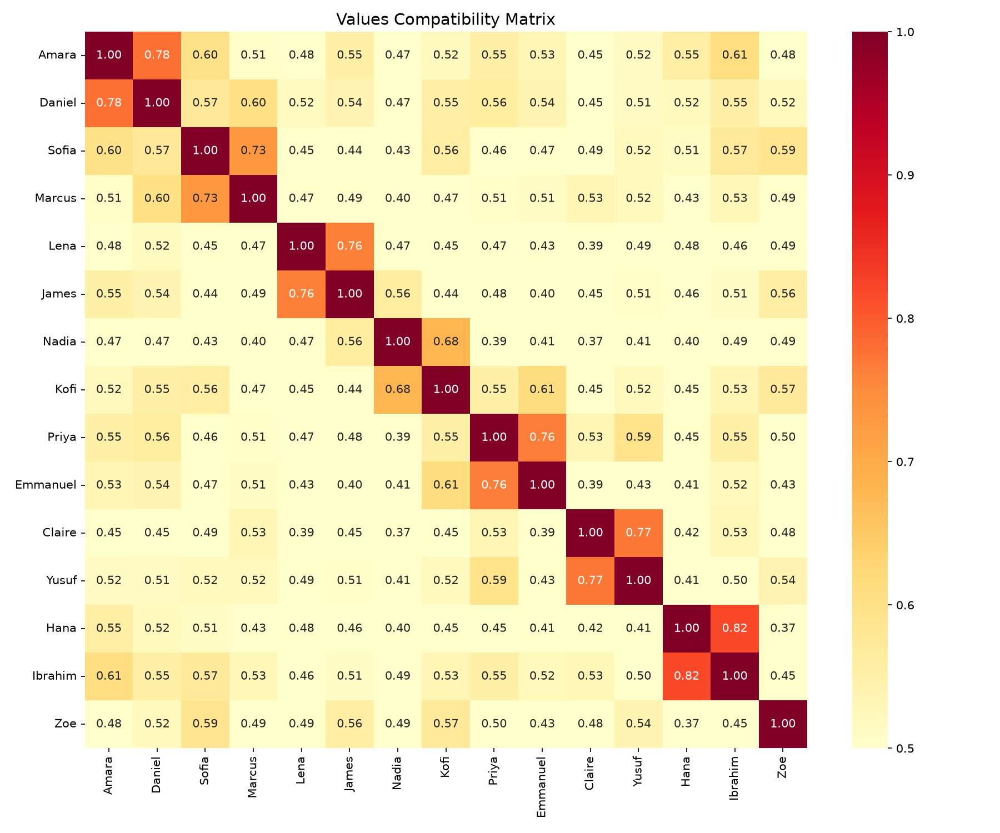

# values-match

A lightweight values-based compatibility engine using sentence embeddings 
and semantic similarity.

## The Problem

Most matching systems compare preferences — age, location, interests. 
But values are different. "I believe children need structure" and 
"consistent routines help kids thrive" mean the same thing expressed 
differently. Keyword matching misses this entirely. Embeddings catch it.

## How It Works

1. User profiles are defined by natural language values and life goal statements
2. Each profile is converted into a semantic embedding using a 
   sentence transformer model
3. Cosine similarity measures how aligned two profiles are in values space
4. Top matches are returned ranked by compatibility score

## Tech Stack

- Python 3.9+
- LangChain for embedding pipeline
- sentence-transformers (all-MiniLM-L6-v2) for local embeddings
- scikit-learn for cosine similarity computation
- NumPy and Pandas for data handling
- Jupyter for exploration and visualization

## Setup

```bash
git clone https://github.com/YOUR_USERNAME/values-match.git
cd values-match
python -m venv venv
source venv/bin/activate  # Windows: venv\Scripts\activate
pip install -r requirements.txt
```

## Usage

Run matching for default sample users:
```bash
python -m src.main
```

Run matching for a specific user:
```bash
python -m src.main user_007
```

Valid user IDs: user_001 through user_015

## Example Output



## Explore the Data

Open the notebook to visualize compatibility across all profiles:
```bash
jupyter notebook notebooks/exploration.ipynb
```

## What I Would Build Next

- **Weighted values**: some values matter more than others and should 
  contribute more to the compatibility score
- **Conflict detection**: explicitly flag profiles with fundamentally 
  incompatible values rather than just ranking by similarity
- **Feedback loop**: use match outcomes to improve embedding weights over time
- **Multi-dimensional scoring**: separate scores for parenting style, 
  lifestyle preferences, and long-term goals rather than one combined score
- **API layer**: wrap the matcher in a FastAPI endpoint so it can serve 
  matches to a frontend application